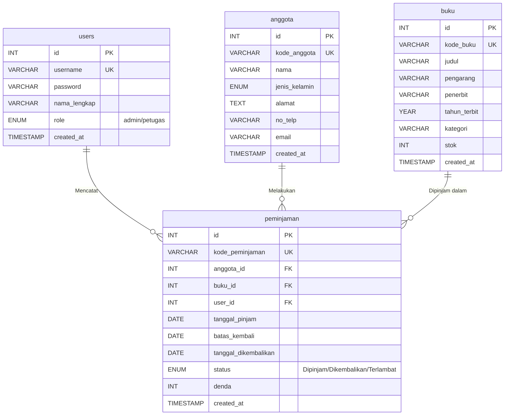

# Entity Relationship Diagram (ERD) - Tugas 2

Berikut adalah skema Entity Relationship Diagram untuk database `db_perpustakaan` menggunakan representasi Mermaid.

*Tugas Mandiri: Silakan gunakan fitur "Designer" pada phpMyAdmin Anda, lalu ekspor (save as image) menjadi file `docs/erd.png`. Atau Anda juga dapat melakukan screenshot dari diagram di bawah ini (menggunakan ekstensi Markdown Preview).*

